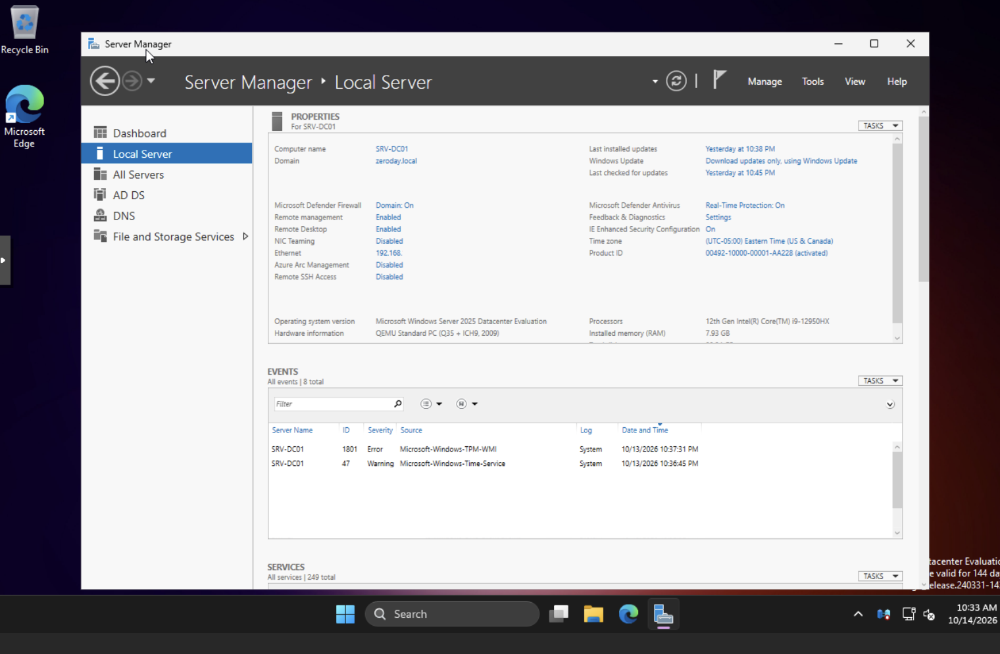
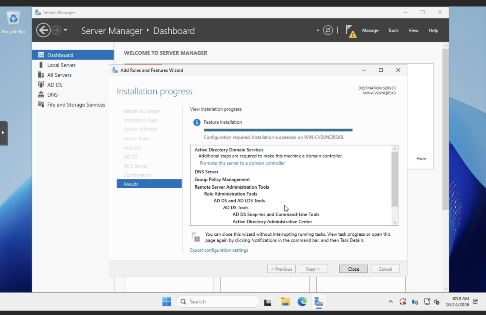
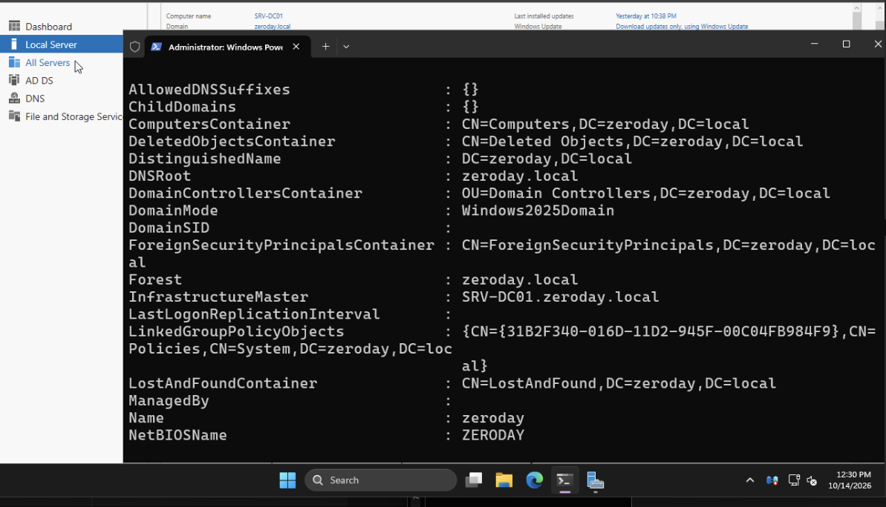
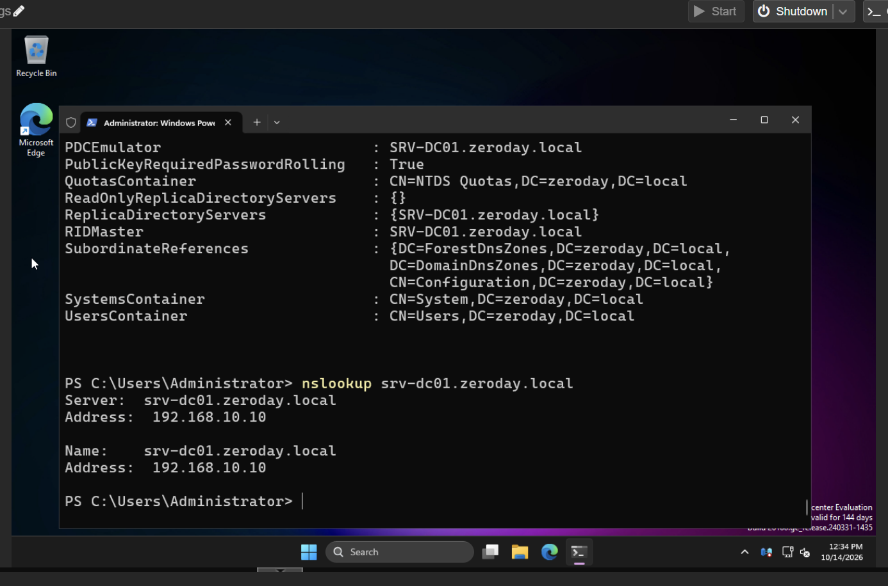
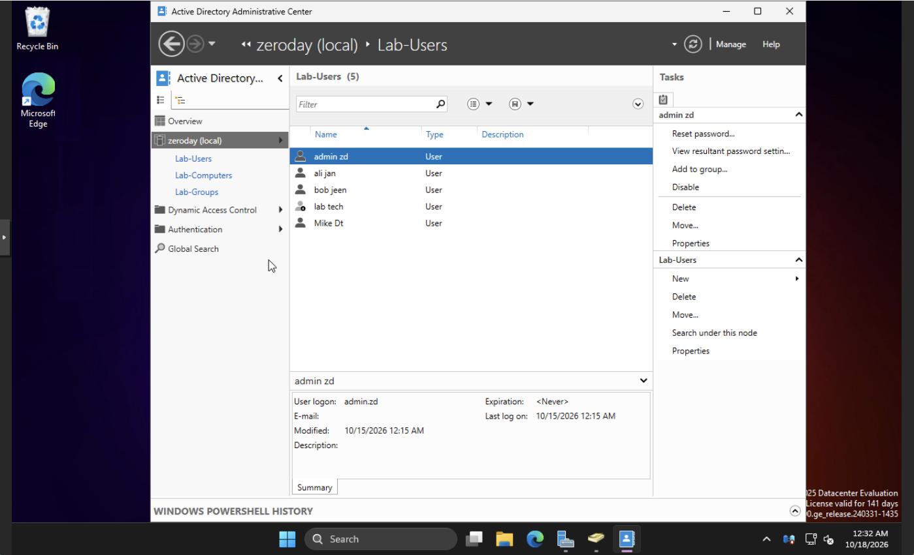
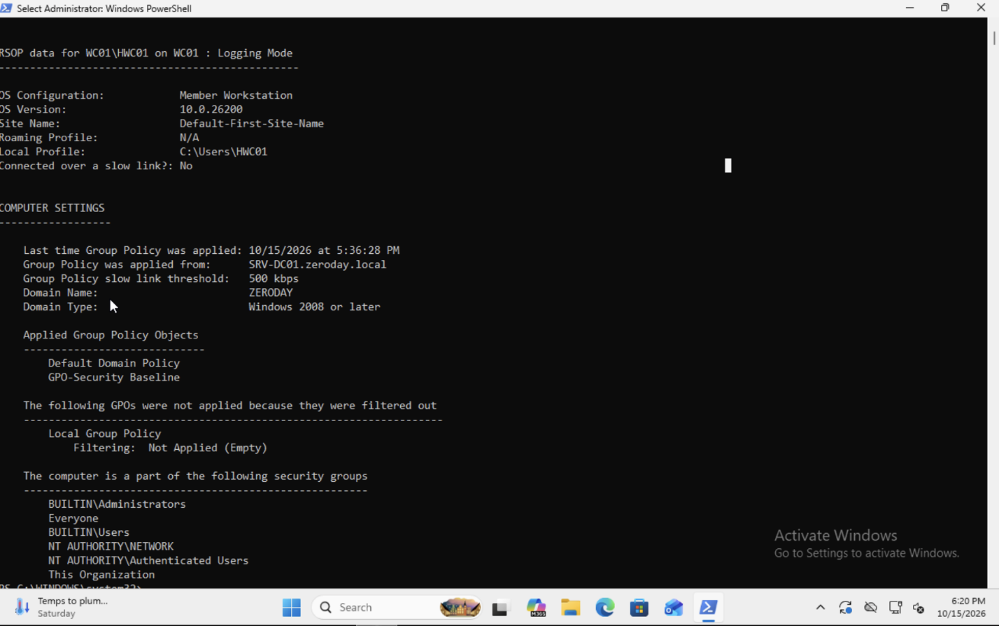
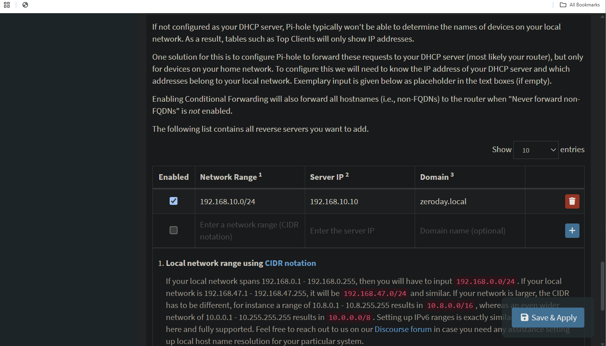
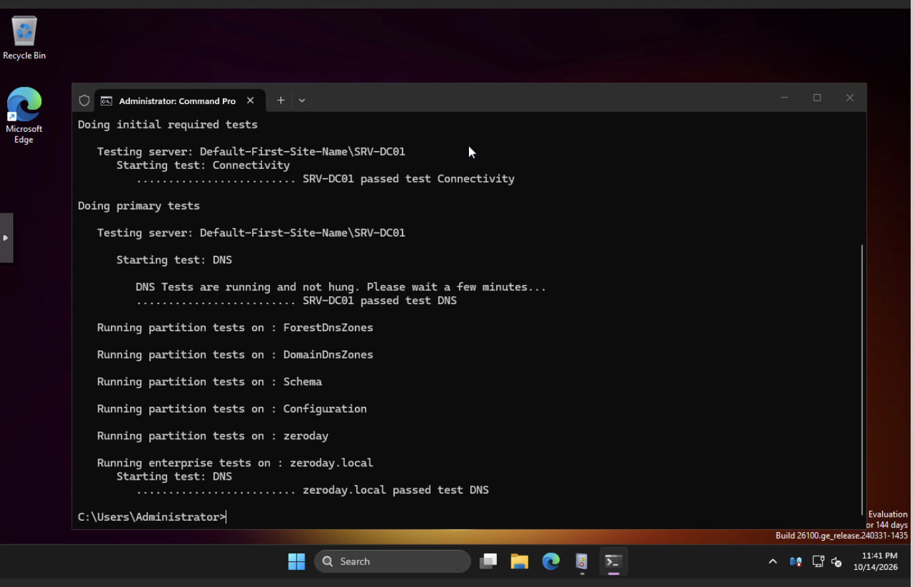
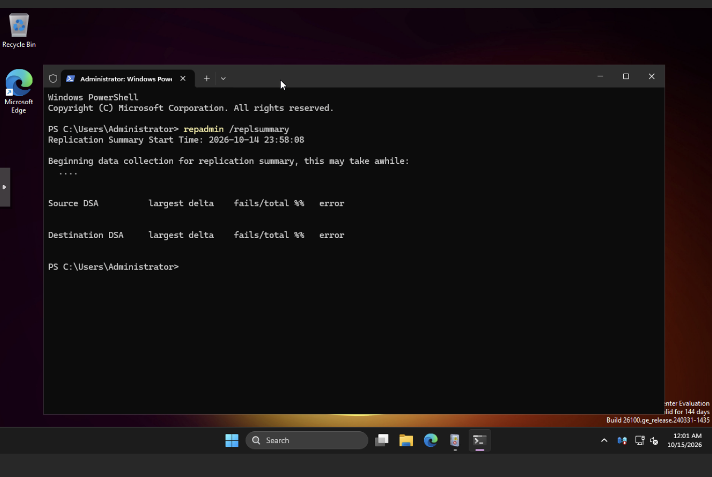

# Active Directory & Windows Security Lab

A hands-on homelab that deploys a **Windows Server 2025 Active Directory domain** (`zeroday.local`) and hardens it with Group Policy, Advanced Audit Policy and DNS-level filtering. It runs on Cisco networking gear and a Proxmox VE hypervisor, and mirrors the core pieces of a small enterprise network.

> **Lab-only project.** All hosts, IP addresses and accounts are private and isolated. Some settings (for example, password complexity disabled) are deliberate lab choices, so do not copy them into production unchanged.

## Contents

- [Objectives](#objectives)
- [Architecture](#architecture)
- [Lab components](#lab-components)
- [Active Directory structure](#active-directory-structure)
- [Group Policy security baseline](#group-policy-security-baseline)
- [Validation and testing](#validation-and-testing)
- [Screenshots](#screenshots)
- [Challenges and troubleshooting](#challenges-and-troubleshooting)
- [Lessons learned](#lessons-learned)
- [Future enhancements](#future-enhancements)
- [Technologies used](#technologies-used)

## Objectives

- Deploy Windows Server 2025 as an Active Directory domain controller.
- Configure AD DS and integrate DNS with Pi-hole for upstream filtering and name resolution.
- Build an OU hierarchy with domain users and security groups.
- Enforce a Group Policy security baseline, including workstation hardening.
- Join a Windows 11 client to the domain and validate the trust.
- Configure password length and history, no forced expiry, and account lockout.
- Enable and tune Windows auditing (logon events, policy changes, account management).
- Validate policy with `gpresult`, Resultant Set of Policy (RSoP) and Group Policy Modeling.
- Generate and analyze a failed authentication event (Event ID 4625).

## Key outcomes

- Working domain controller with AD DS, Kerberos authentication and integrated DNS.
- One domain-wide baseline GPO covering password, lockout, audit and workstation hardening.
- Advanced Audit Policy validated with events **4624, 4625, 4720, 4732, 4738 and 4719**.
- Hardened Windows 11 workstation (Firewall, Defender, SmartScreen, least privilege).
- Pi-hole DNS filtering with conditional forwarding to Active Directory DNS.
- Documented troubleshooting for DNS, GPO processing, replication, audit gaps and permissions.

## Architecture

```text
Cisco Router
 └── Cisco Switch
      ├── Proxmox VE host (pve01)
      │    └── Proxmox VE hypervisor (KVM/QEMU)
      │         ├── SRV-DC01 (VM)
      │         │    ├── Windows Server 2025
      │         │    ├── Active Directory Domain Services (AD DS)
      │         │    ├── Domain DNS (zeroday.local)
      │         │    └── Group Policy security baseline
      │         └── WC01 (VM)
      │              ├── Windows 11 Pro
      │              └── Joined to zeroday.local
      └── Pi-hole DNS server
           ├── DNS filtering
           └── Forwards zeroday.local queries to SRV-DC01
```

## Lab components

| Component | Platform | OS / software | Role | Key configuration |
|---|---|---|---|---|
| Cisco router and switch | Physical | Cisco IOS | Lab connectivity | DHCP, basic routing, switchport security; no VLAN segmentation |
| pve01 | Physical host | Proxmox VE (KVM/QEMU) | Hypervisor | Hosts SRV-DC01 and WC01 |
| SRV-DC01 (`192.168.10.10`) | Virtual machine | Windows Server 2025 | Domain controller, DNS for `zeroday.local` | AD DS, Group Policy, Kerberos, auditing, NTP time sync |
| Pi-hole | Linux server | Pi-hole | DNS filtering and upstream resolver | Blocks ad and malicious domains; conditional forwarding of `zeroday.local` to SRV-DC01 |
| WC01 | Virtual machine | Windows 11 Pro | Domain-joined workstation | Joined to `zeroday.local`; GPO applied; auditing enabled |

## Active Directory structure

**Organizational units**

| OU | Purpose |
|---|---|
| `Lab-Users` | Standard and administrative user accounts |
| `Lab-Computers` | Domain-joined workstation and server objects |
| `Lab-Groups` | Security groups for access control and GPO targeting |

**User accounts** (all in `Lab-Users`)

| Display name | Username | Role | Notes |
|---|---|---|---|
| Mike Dt | `mike.dt` | Standard user | General workstation user |
| Bob Jeen | `bob.jeen` | Standard user | Used for GPO testing |
| Admin ZD | `admin.zd` | Domain admin | Primary administrative account |
| Lab Technician | `lab.tech` | Power user | Elevated permissions for lab operations |
| Ali Jan | `ali.jan` | Standard user | General workstation user |

**Security groups**

| Group | Members |
|---|---|
| `GG-IT-Admin` | admin.zd |
| `GG-Helpdesk` | lab.tech |
| `GG-Standard-Users` | mike.dt, bob.jeen |
| `GG-Workstation-Admins` | admin.zd |
| `GG-GPO-Workstations` | mike.dt, bob.jeen |
| `GG-Lab-Admin` | admin.zd |

## Group Policy security baseline

A domain-level GPO named **GPO-Security Baseline** is linked at `zeroday.local` and applies to all users and computers, including WC01 and SRV-DC01.

| Control | Setting |
|---|---|
| Password history | 10 passwords remembered |
| Maximum / minimum password age | 0 days / 0 days (no forced rotation) |
| Minimum password length | 14 characters |
| Password complexity | Disabled |
| Reversible encryption | Disabled |
| Lockout threshold | 10 invalid attempts |
| Lockout duration | 30 minutes |
| Reset lockout counter after | 30 minutes |
| Advanced Audit Policy | Account Logon, Account Management, Logon/Logoff, Policy Change, Security Group Management, User Account Management |
| Workstation hardening (WC01) | Windows Firewall, Defender real-time protection and SmartScreen enabled; standard users without local admin rights |

## Validation and testing

| Test | Result |
|---|---|
| Password length and history | 14-character minimum and 10-password history enforced |
| Account lockout | Locks at 10 invalid attempts, stays locked 30 minutes, counter resets after 30 minutes |
| Audit events | 4624, 4625, 4720, 4732, 4738 and 4719 recorded on SRV-DC01 |
| Failed logon test | WC01 to SRV-DC01 as `bob.jeen`: event 4625 (logon type 3, NTLM) with matching 4776 |
| Policy application | `gpresult /r` and RSoP confirm GPO-Security Baseline on SRV-DC01 and WC01 |
| Workstation hardening | Firewall, Defender and SmartScreen active; standard users not local admins; `admin.zd` is admin through `GG-Workstation-Admins` |
| DNS and replication | `dcdiag /test:dns` passed; `repadmin /replsummary` shows no errors |

## Screenshots

### 1. Event ID 4624: successful logon

Event 4624 on SRV-DC01 for a successful network logon (type 3, NTLM) of `bob.jeen` from WC01.


### 2. Event ID 4625: failed logon

Event 4625 on SRV-DC01: failed network logon, status `0xC000006D` / sub-status `0xC000006A` (valid account, wrong password).


### 3. Event ID 4720: user account created

Event 4720 confirming User Account Management auditing recorded the creation of `ali.jan`.


### 4. Server initial configuration

Server Manager local server properties for SRV-DC01 in the `zeroday.local` domain.



### 5. IP configuration

Network configuration of the domain controller (`ipconfig`).


### 6. AD DS installation

Add Roles and Features wizard: AD DS and DNS role installation completed.



### 7. AD prerequisites passed

AD DS Configuration Wizard: prerequisites check passed.


### 8. Domain controller verification

Domain properties confirming `zeroday.local` and SRV-DC01 as infrastructure master.



### 9. DNS resolution

`nslookup` resolves `srv-dc01.zeroday.local` to `192.168.10.10`.



### 10. Active Directory structure

Organizational units: Lab-Users, Lab-Computers and Lab-Groups.


### 11. Test users

Lab-Users OU containing the five lab user accounts.



### 12. Security groups

Lab-Groups OU containing the six security groups.


### 13. GPO link

GPO-Security Baseline linked at the `zeroday.local` domain level.


### 14. Password policy

Password policy settings in GPO-Security Baseline.


### 15. Account lockout policy

Account lockout policy settings in GPO-Security Baseline.


### 16. GPO verification on SRV-DC01

Default Domain Controllers Policy, Default Domain Policy and GPO-Security Baseline applied on the DC.


### 17. GPO verification on WC01

Default Domain Policy and GPO-Security Baseline applied on the workstation.



### 18. Pi-hole conditional forwarding

`zeroday.local` forwarded to SRV-DC01 (`192.168.10.10`); Pi-hole keeps filtering external DNS.



### 19. DNS Manager verification

Required AD SRV records present (LDAP, Kerberos, Global Catalog, DC locator); no stale entries.


### 20. dcdiag DNS health check

`dcdiag /test:dns` passed for all partitions and the enterprise DNS test.



### 21. Replication health

`repadmin /replsummary` reporting no replication errors.



### 22. Domain-joined client

WC01 joined to `zeroday.local` (Windows 11 Pro, Settings → System → About).


## Challenges and troubleshooting

| Area | Problem | Fix |
|---|---|---|
| AD configuration | Domain join failed | WC01 DNS was not pointing to the domain controller; corrected the DNS setting |
| AD configuration | New users and groups not visible | Refreshed the console view |
| Group Policy | Settings did not apply | Ran `gpupdate /force` and verified the OU link |
| Group Policy | Password and lockout policies ignored | They only work when applied at the **domain** level; workstation-level GPOs were ignored |
| Audit logging | Some events missing | Default audit settings were still active; enabled Advanced Audit Policy |
| Audit logging | Hard to find events | Filtered Event Viewer by ID (4738, 4624, 4625, 4720, 4732, 4719) |
| Workstation permissions | Standard users had local admin rights | Enforced `GG-Workstation-Admins` through policy |
| Workstation permissions | `admin.zd` lacked local admin on WC01 | Added `GG-Workstation-Admins` to local Administrators through policy |
| DNS | Pi-hole could not resolve AD names | Added conditional forwarding to the domain controller |

## Lessons learned

- A clean OU structure is essential for GPO targeting and scalability.
- Separating standard, admin and service accounts prevents privilege creep.
- Domain-level policies override local settings, so GPO precedence matters.
- Advanced Audit Policy gives more detailed and useful logging than legacy audit settings.
- Enforce least privilege through security groups, not local configuration.
- `gpresult /r` and Event Viewer are the key tools for diagnosing GPO issues.
- DNS and time synchronization are foundational; Active Directory breaks quickly without them.

## Future enhancements

- **Windows LAPS:** unique, automatically rotated local administrator passwords.
- **Sysmon + Wazuh:** endpoint telemetry forwarded to a SIEM for detection and investigation.
- **Network segmentation:** VLANs on the Cisco switch to isolate domain controllers, workstations and management.
- **Kerberos-only authentication:** disable NTLM after validating application compatibility.
- **BitLocker + TPM:** encrypt workstation drives to protect data at rest.
- **AppLocker or WDAC:** application control to enforce a trusted software baseline.

## Technologies used

- **Operating systems and directory:** Windows Server 2025, Windows 11, Active Directory Domain Services
- **Group Policy and security:** GPMC, Advanced Audit Policy, Windows Defender, Windows Firewall, SmartScreen
- **Networking and infrastructure:** Pi-hole, Cisco networking equipment, Proxmox VE
- **Tools:** DNS Manager, `dcdiag`, `repadmin`, `nslookup`, Active Directory Administrative Center, ADUC, Server Manager, Event Viewer, `gpresult`, `gpupdate`, PowerShell
