# Screenshots

Evidence from the Active Directory & Windows Security Lab, in the order of the project report.

## 1. Event ID 4624: Successful Logon

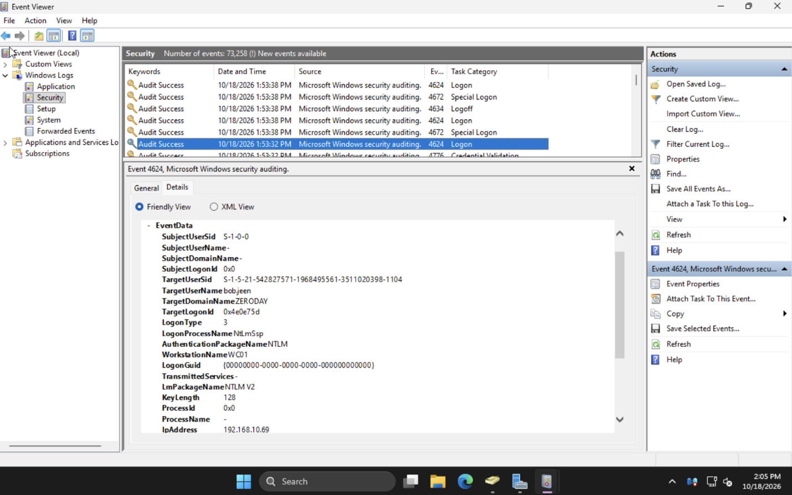

## 2. Event ID 4625: Failed Logon

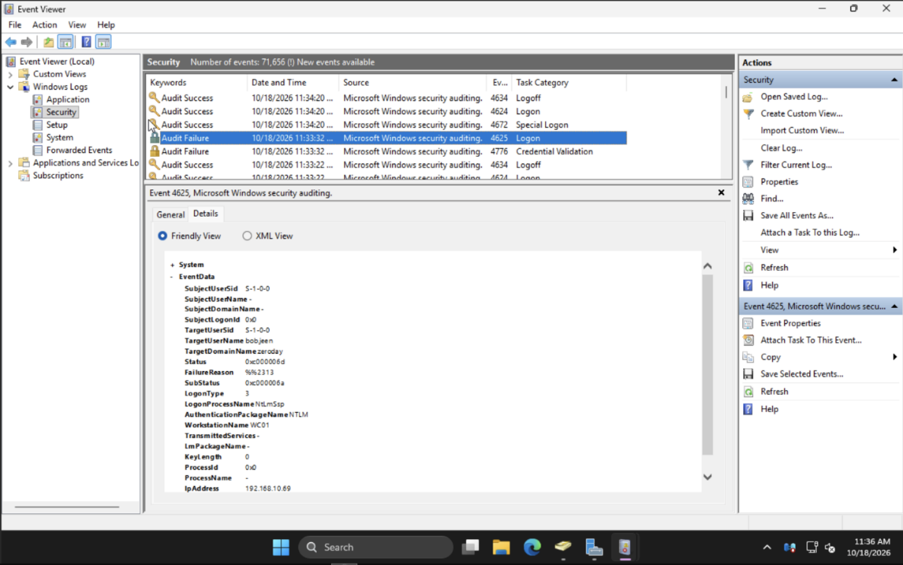

## 3. Event ID 4720: User Account Created

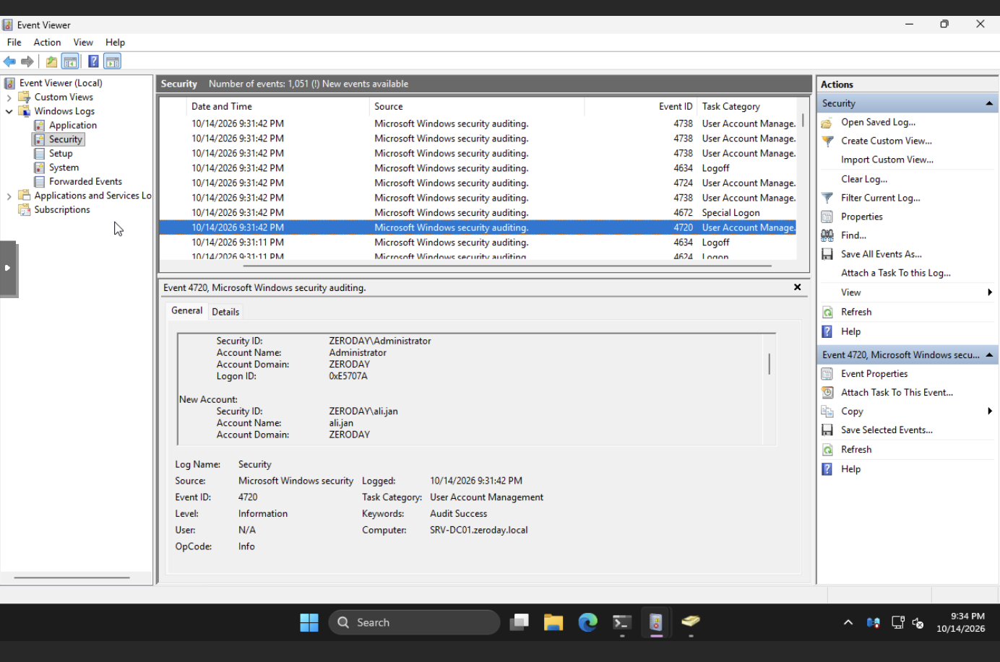

## 4. Server Initial Configuration

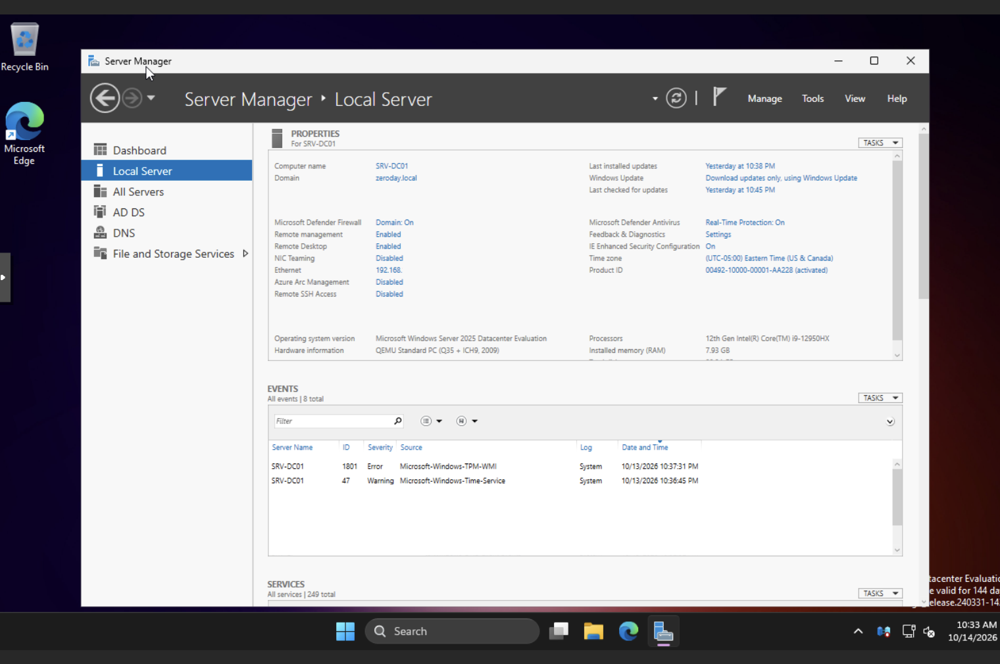

## 5. IP Configuration

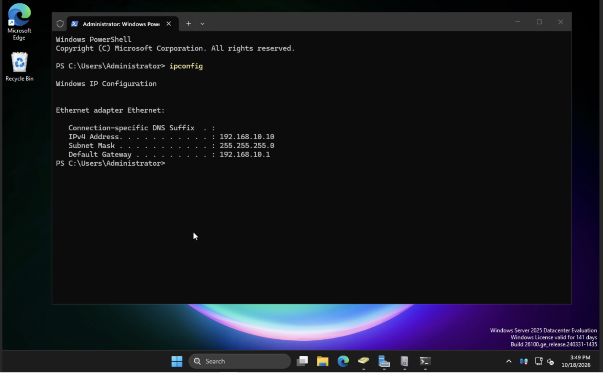

## 6. Active Directory Domain Services Installation

## 7. AD Prerequisites Passed

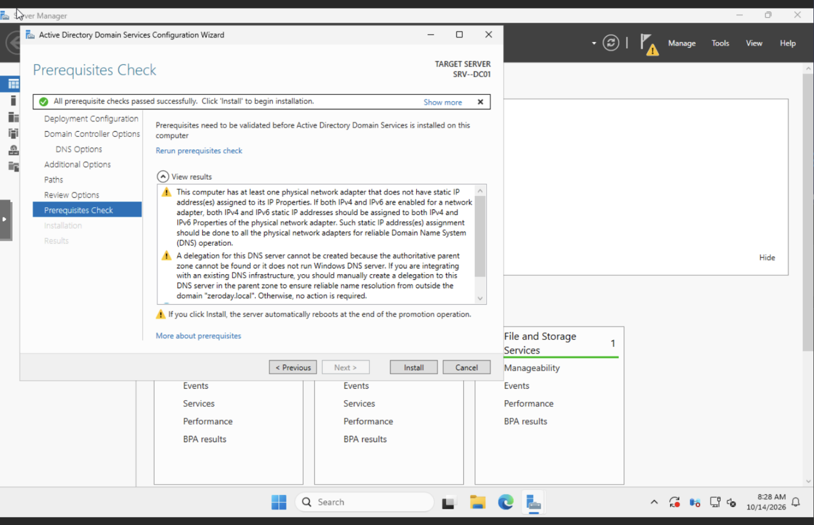

## 8. Domain Controller Verification

## 9. DNS Resolution

## 10. Active Directory Structure

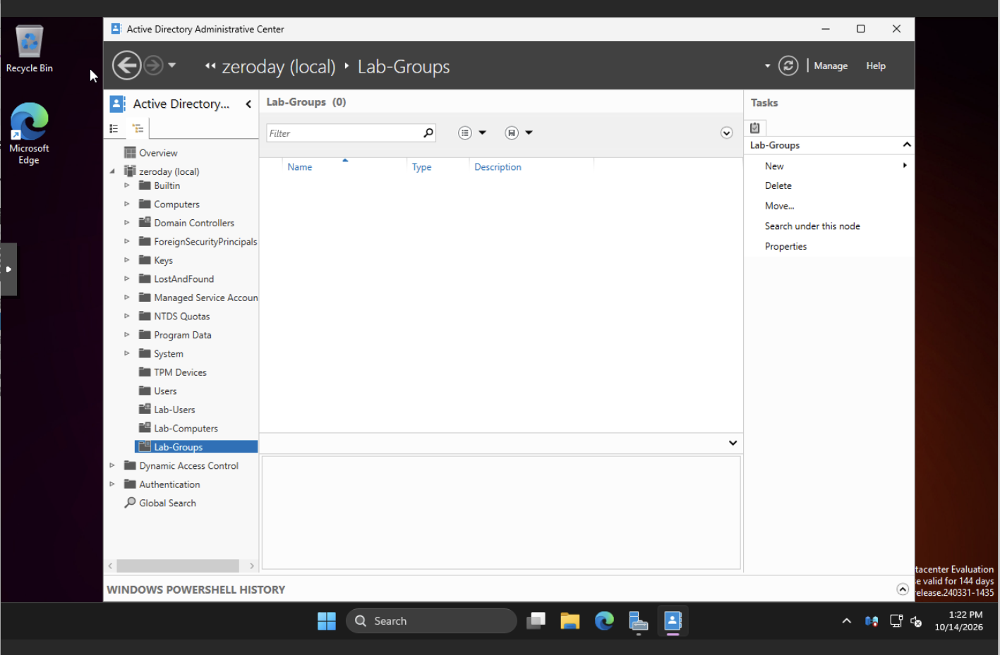

## 11. Test Users

## 12. Security Groups

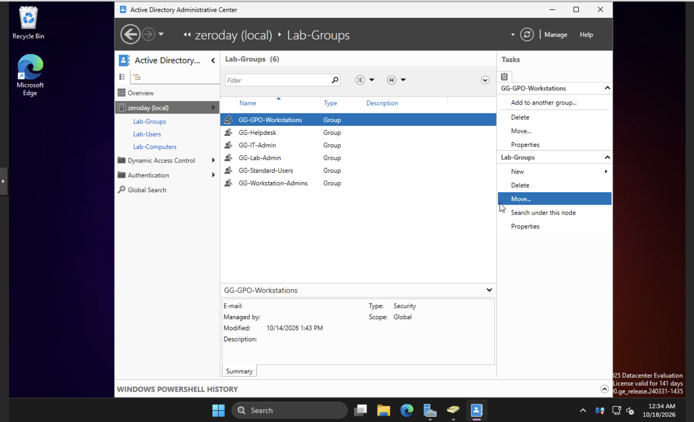

## 13. Security Configuration (GPO Link)

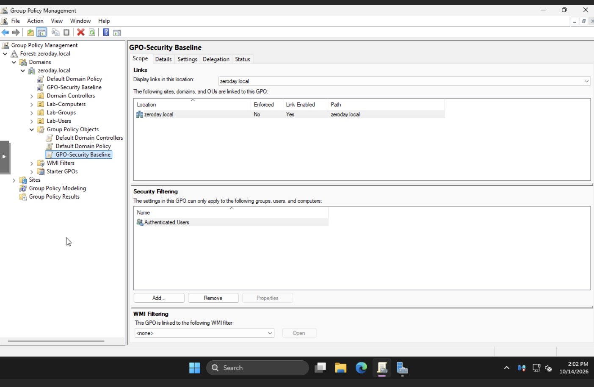

## 14. Password Policy

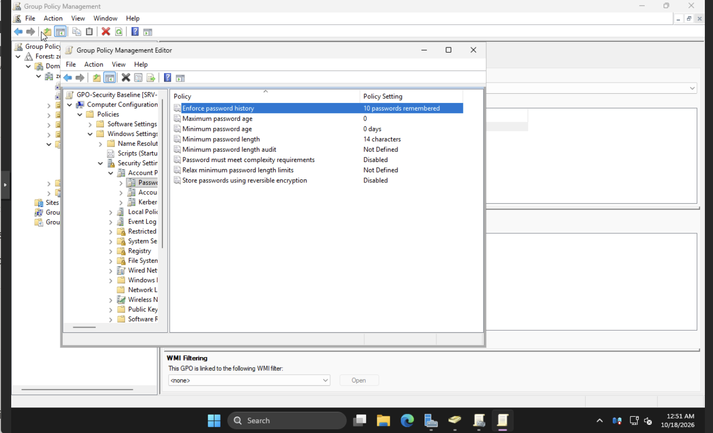

## 15. Account Lockout Policy

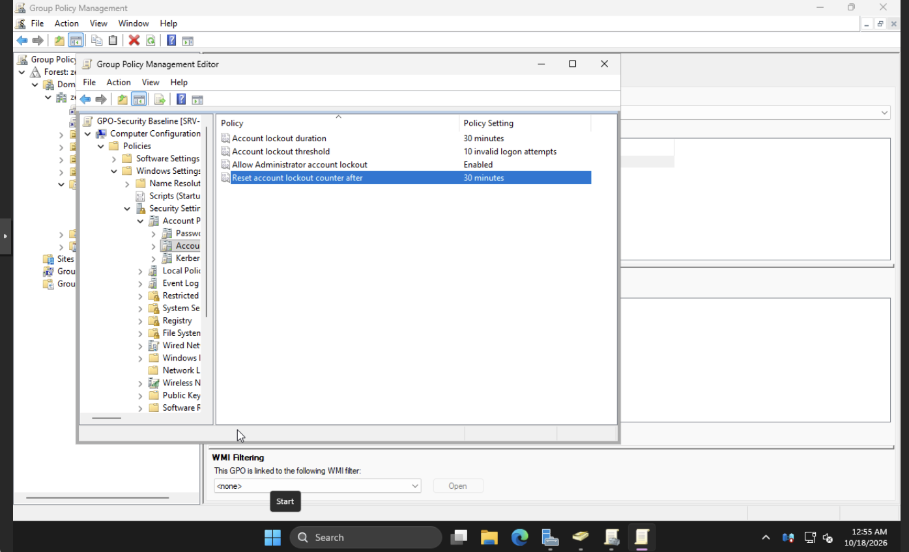

## 16. Domain Controller GPO Verification (SRV-DC01)

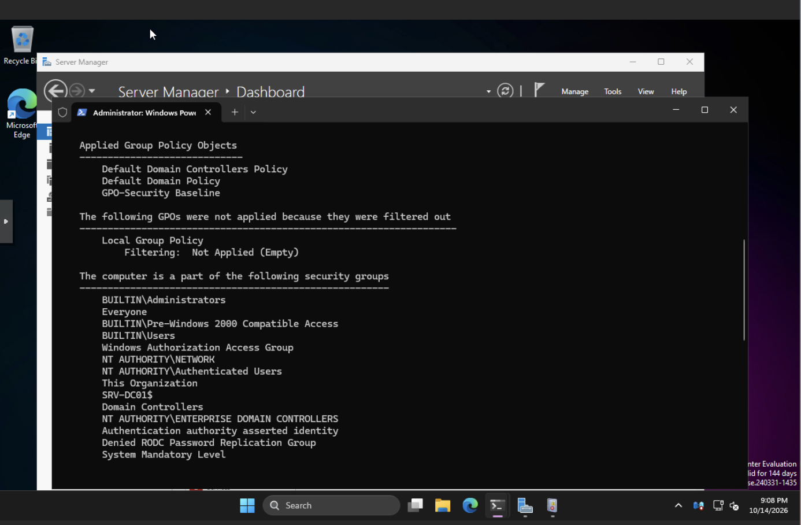

## 17. Workstation GPO Verification (WC01)

## 18. DNS Conditional Forwarding Verification

## 19. DNS Manager Verification

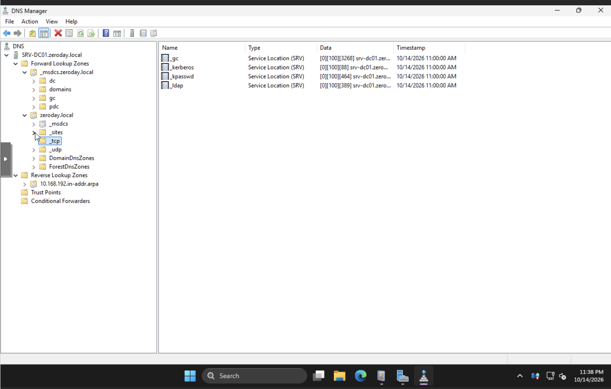

## 20. dcdiag DNS Health Check

## 21. Replication Health Verification

## 22. Client & Security Validation

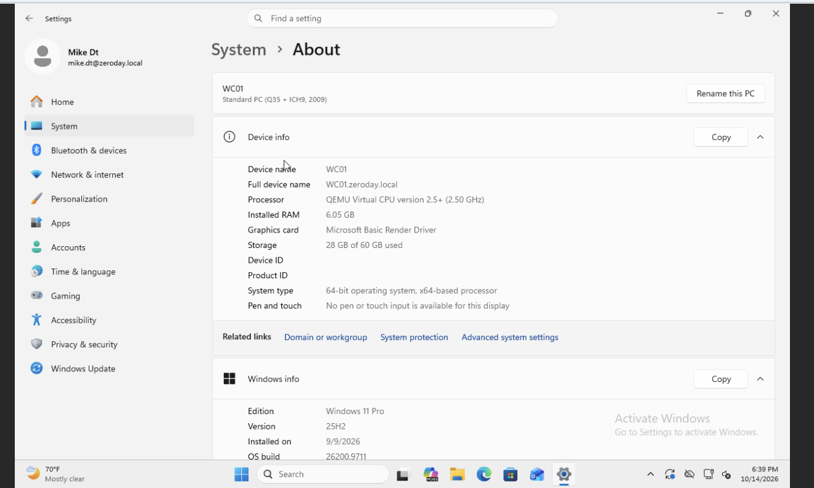
